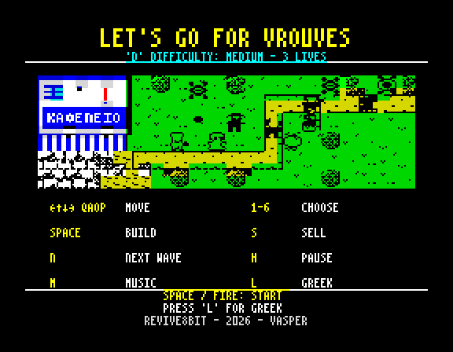
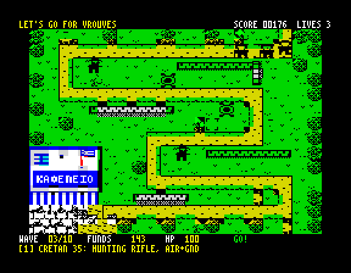

# LET'S GO FOR VROUVES / ΠΑΜΕ ΓΙΑ ΒΡΟΥΒΕΣ — ZX Spectrum

A top-down tower defence game for the **ZX Spectrum 48K and 128K**, written in **Z80
assembly**. It is the Spectrum version of the [Amstrad CPC game](../VrouvesCPC): the same seven
stages, waves, defenders, invaders, rules, score, lives, texts (English and Greek) and music;
the picture, the sound, the keys and the tape are the Spectrum's.

Armed with EU Directive 8647/2026, Frankenstein & Moreau CO. send bio-drones, compliance
squads and weed-destroying tanks to wipe out the wild, "copyrighted" *vrouves* of Crete.
In Zoniana, the villagers have to protect the Kafenio and its sacks of bitter greens.
The rebel corporate drone **Psssst** has defected to their side.

**Player's manual:** [English](docs/MANUAL.md) · [Ελληνικά](docs/MANUAL_GR.md) ·
how the port works: [planzx.md](planzx.md) (in Greek)

| | |
|---|---|
|  |  |

## Running

```bash
make
```

builds `build/vrouves.tap` and `build/vrouves.tzx` (a BASIC loader, the loading screen, the
code, the ending's picture) and the snapshots `build/vrouves48.z80` and `build/vrouves128.z80`.

On a 48K: `LOAD ""`; on a 128K / +2: Tape Loader. A 128K's loader goes on to put the ending's
picture in RAM bank 1; on a 48K the game starts as soon as the code is in, and reads the ending
from the tape when the last stage is won (SPACE skips it).

## Controls

| Key | Action |
| --- | --- |
| Cursor keys (CAPS SHIFT + 5-8) / Q A O P / Kempston | Move the build cursor |
| 1 – 6 | Choose a defender |
| SPACE / ENTER / FIRE | Build on the cursor cell |
| S / DELETE | Sell the defender under the cursor (half price back) |
| N | Call the next wave now (half the seconds left on the countdown are paid as a bonus) |
| H | Pause / continue (BREAK while paused quits to the title) |
| L | Switch English / Greek at any time |
| M | Music on / off |

On the title screen, → (or P, or the joystick right) flips between the pages: a scene with the
keys, the story, the defenders, the invaders and the high scores. D picks the difficulty (the
lives for the whole game: Easy 4, Medium 3, Hard 2, Hardest none). The high score table lasts
while the Spectrum is on. There is no Sinclair joystick: its keys are the defenders' numbers.

## The game

Everything about the rules is the CPC's, tick for tick (see its
[README](../VrouvesCPC/README.md)): six defenders that join the village stage by stage, the
neighbour bonus (three defenders at most), three invaders, ten waves a stage, the score, the
lives, and the feast at the school when the last stage is won. `src/game.asm` is the CPC's
game logic as it was; only the drawing, the HUD and the banner are new.

## On the Spectrum

- **The playfield**: 20 × 14 cells of 12 × 12 pixels, 240 × 168 at (8, 8). A CPC cell is
  8 × 12 Mode 0 pixels; each Mode 0 pixel becomes one or two Spectrum pixels (1, 2, 1, 2, 2, 1,
  2, 1 across a cell, so a mirrored sprite stays a mirror). The CPC's coordinates are kept in
  the logic (a CPC byte is 3 of our pixels) and converted only when drawing.
- **Colour**: every attribute cell of the playfield has black ink and a paper of its own: the
  colour most of its pixels have (`tools/zxcolour.py`), the others black, paper or a
  checkerboard of both by how dark they are. The sprites are drawn in ink with a ring of
  paper round them (their mask), so they show on any part of the village with no attribute
  clash; the Kafenio and the other buildings, where hardly anything walks, take any two
  colours a cell.
- **Tiles**: the stages are drawn from 343 tiles of 12 × 12 shared by all of them (18 bytes
  each); a stage has its tile map, cell types, sacks, paths, waves and texts packed (LZ,
  `tools/lz.py`, `src/lz.asm`), and its attributes.
- **No flicker**: the playfield is drawn in a work buffer and only what changed is copied to the
  screen. A sprite saves what it covers before it is drawn; each frame they are all taken off
  again, newest first, the background's changes (a defender built, a sack gone, the banner)
  are made, the sprites go on again and the changed rectangles go to the screen.
- **The pace**: as on the CPC, a frame is drawn every fourth 50 Hz frame (12.5 fps) with two
  25 Hz ticks of logic in it. In the heaviest waves a pass takes about 4 frames on average.
- **Text**: the CPC's 3×6 font, 64 columns; the HUD is a line above the playfield and two
  below it, a message of two lines that does not fit side by side takes turns.
- **Sound**: the CPC's player, stepped by the interrupt into a shadow of the AY's registers.
  On a 128K they go to the AY (the periods scaled from the CPC's 1 MHz to 1.7734 MHz); on a
  48K the beeper plays the effect, or else the melody, in the time each frame leaves free
  (Sugar Byte's beeper): the tune on the title, the effects in the game.
- **The ending**: on a 128K, the loader puts the picture in bank 1; a 48K reads it off the tape
  with the ROM's LD-BYTES (past its BREAK check, so SPACE just skips it).

Memory: `#5B00` line tables, `#6000` the code and data (28.8K: tiles 6.2K, stages 7K, text
2.6K, sprites 1.7K, code 9.2K), then entities, variables, the current stage, the save buffer
and the work buffer up to `#F650`; the IM 2 table at `#FD00`.

## Building

Requirements: [rasm](https://github.com/EdouardBERGE/rasm), Python 3 with Pillow and the
[`z80`](https://pypi.org/project/z80/) module; FBZX for `make run`; for `make check`
floooh/chips (`../CPCTools/cpcemu/chips`) and the Spectrum ROMs (`/usr/share/spectrum-roms`).

```bash
make            # tape and snapshots
make run        # the tape in FBZX
make test       # the scripts of tests/ and a whole game played through, 48K and 128K
make check      # the tape through the real 48K and 128K ROMs
make debug      # build/debug.bin: rich, at wave 9, every defender
make pictures   # the loading screen and the ending again
```

`tools/zxrun.py` is a headless Spectrum (the `z80` module, the interrupt, keyboard, Kempston,
beeper, AY and paging, and the ROM's tape loader trapped) that runs scripts (`tests/*.txt`),
takes screenshots and profiles (`profile N`, `loops`); `tests/stress.txt` (on `make debug`'s
build) builds two dozen defenders and runs a late wave. `tests/full.py` plays a whole game.
`tools/manual_images.py` makes the manuals' pictures.

## Layout

```
src/        main (memory map, start, stages, ending), hw (interrupt, keys, AY, paging),
            sound, gfx (buffers, sprites, tiles, text), game (the rules, the HUD), title
            (pages, high scores), lz, loader.bas
tools/      zxdata.py (all the data), zxcolour.py (the colours, the conversions), world.py,
            art.py, font.py, texts.py (the CPC's world), lz.py, mktap.py, mkz80.py,
            zxrun.py, zxcheck.py (+ zxemu/), manual_images.py
assets/     the loading picture and the ending (from the CPC version)
tests/      the scripts of make test, full.py
docs/       the player's manual, English and Greek
```

---

**REVIVE8BIT · 2026 · VASPER**
