# ΠΑΜΕ ΓΙΑ ΒΡΟΥΒΕΣ

*Ένα παιχνίδι tower defence για τον ZX Spectrum 48K και 128K*

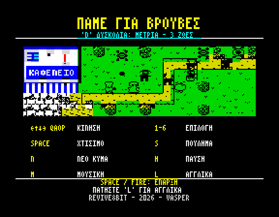

## Η ιστορία

Οπλισμένοι με την Οδηγία ΕΕ 8647/2026, οι κολοσσοί της **Frankenstein & Moreau Co.**
στέλνουν βιο-ντρόνα, συνεργεία και βαριά μηχανήματα για να ξεριζώσουν τις *βρούβες* – τα
άγρια, «κατοχυρωμένα» χόρτα των βουνών της Κρήτης.

Στα Ζωνιανά οι χωριανοί δεν το δέχονται. Στήσε τους υπερασπιστές για να προστατέψεις το
καφενείο, την εκκλησία, το δημαρχείο και όλο το χωριό, και πάνω απ' όλα τα πολύτιμα τσουβάλια
με τα πικρά χόρτα. Ευτυχώς το επαναστατημένο εταιρικό ντρον **Ψσσστ** αυτομόλησε και πολεμά
δίπλα στους οχυρωμένους χωριανούς.

## Φόρτωμα

Χρειάζεσαι ZX Spectrum 48K, 128K, +2 ή +3 (ή έναν εξομοιωτή) και την κασέτα `vrouves.tap` (ή
`vrouves.tzx`). Σε έναν 48K γράψε:

```
LOAD ""
```

και πάτα ENTER· σε 128K ή +2 διάλεξε **Tape Loader** από το μενού. Μετά πάτα PLAY.

Όσο φορτώνει το παιχνίδι φαίνεται η εικόνα φόρτωσης. Στον 128K η κασέτα συνεχίζει με την
εικόνα του τέλους, που περιμένει στην επιπλέον μνήμη του 128K ώσπου να κερδίσεις την τελευταία
πίστα. Ο 48K δεν έχει χώρο γι' αυτήν: το παιχνίδι ξεκινά μόλις φορτώσει και μπορείς να
σταματήσεις εκεί την κασέτα. Το τέλος είναι το τελευταίο κομμάτι της κασέτας, και όταν
κερδίσεις την τελευταία πίστα ο 48K σου ζητά να πατήσεις PLAY για να το δεις (με SPACE το
προσπερνάς).

Σε εξομοιωτή, τα snapshots `vrouves48.z80` και `vrouves128.z80` ξεκινούν αμέσως το παιχνίδι
(το 128K μαζί με το τέλος).

**Ήχος:** ο 128K παίζει τη μουσική και τα εφέ στο τσιπ ήχου του. Ο 48K τα παίζει στο beeper:
τη μουσική στην αρχική οθόνη, και μέσα στο παιχνίδι μόνο τα εφέ, γιατί το beeper ακούγεται μόνο
στον χρόνο που αφήνει ελεύθερο το παιχνίδι. Με το M ανοίγει και εκεί η μουσική.

## Η αρχική οθόνη

Η αρχική οθόνη ανοίγει με μια σκηνή από το παιχνίδι και τα βασικά πλήκτρα, μετά λέει την
ιστορία και δείχνει τους υπερασπιστές, τους εισβολείς και τα καλύτερα σκορ.

| Πλήκτρο | Τι κάνει |
| --- | --- |
| SPACE / FIRE | Αρχή του παιχνιδιού |
| → (CAPS SHIFT + 8), P ή joystick δεξιά | Επόμενη σελίδα |
| D | Δυσκολία: Μέτρια, Δύσκολη, Πολύ δύσκολη, Εύκολη |
| L | Εναλλαγή Ελληνικά / Αγγλικά |
| M | Μουσική ναι / όχι |

Η δυσκολία, που φαίνεται κάτω από τον τίτλο, ορίζει πόσες ζωές έχεις για όλο το παιχνίδι:

| Δυσκολία | Ζωές |
| --- | --- |
| Εύκολη | 4 |
| Μέτρια | 3 |
| Δύσκολη | 2 |
| Πολύ δύσκολη | καμία |

## Η οθόνη του παιχνιδιού

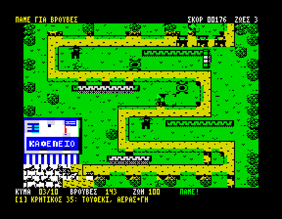

* **Η πάνω μπάρα** δείχνει την πίστα και μηνύματα («χτίσε και πάτα N για το κύμα», «το κύμα
  αποκρούστηκε»). Όταν δεν έχει κάτι να πει, δείχνει τον τίτλο του παιχνιδιού, το σκορ σου και τις
  ζωές που σου μένουν.
* **Το πεδίο** είναι το χωριό. Οι εισβολείς έρχονται από τον δρόμο· τα ντρόνα πετούν από τον
  δικό τους δρόμο, πάνω από τοίχους και δέντρα. Οι υπερασπιστές σου μπαίνουν στο γρασίδι
  δίπλα.
* **Η κάτω μπάρα** δείχνει το κύμα (π.χ. `03/10`), τις βρούβες σου (τα λεφτά του χωριού), τη
  ζωή του κτιρίου που προστατεύεις και τα δευτερόλεπτα ως το επόμενο κύμα (`ΣΕ`), ή `ΠΑΜΕ!`
  όσο κρατά ένα κύμα. Από κάτω, ο υπερασπιστής που διάλεξες με το πλήκτρο του, την τιμή του
  και τι κάνει. Όταν ο κέρσορας είναι πάνω σε δικό σου υπερασπιστή, δείχνει πόσα θα πάρεις αν
  τον πουλήσεις.

## Χειρισμός

| Πλήκτρο | Τι κάνει |
| --- | --- |
| Βελάκια (CAPS SHIFT + 5 6 7 8) / Q A O P / joystick Kempston | Μετακίνηση του κέρσορα |
| 1 – 6 | Επιλογή υπερασπιστή (μόνο όσοι υπάρχουν σε αυτή την πίστα) |
| SPACE / ENTER / FIRE | Χτίσιμο του υπερασπιστή στον κέρσορα |
| S / DELETE (CAPS SHIFT + 0) | Πούλημα του υπερασπιστή κάτω από τον κέρσορα |
| N | Το επόμενο κύμα τώρα |
| H | Παύση / συνέχεια· BREAK (CAPS SHIFT + SPACE) στην παύση γυρνά στην αρχική οθόνη |
| L | Εναλλαγή Ελληνικά / Αγγλικά, οποιαδήποτε στιγμή |
| M | Μουσική ναι / όχι |

Joystick Sinclair δεν υποστηρίζεται: θα πατούσε τα πλήκτρα με τους αριθμούς που διαλέγουν
υπερασπιστή.

Ο κέρσορας δείχνει τις τέσσερις γωνίες του, που αναβοσβήνουν, όταν μπορείς να χτίσεις εκεί, και
ένα Χ όταν δεν μπορείς: το κελί είναι πιασμένο, δεν είναι γρασίδι ή δεν σου φτάνουν οι βρούβες.

## Πώς παίζεται

* Κάθε πίστα έχει **δέκα κύματα**. Πριν από το πρώτο έχεις 45 δευτερόλεπτα για να χτίσεις·
  ανάμεσα στα κύματα, 15. Κάθε πίστα ξεκινά με **120 βρούβες** και **100 ζωή**.
* Κάθε εισβολέας που σταματάς σε πληρώνει: 3 το ντρον, 4 ο φύλακας, 10 το τανκ. Όταν
  αποκρούεις ένα κύμα παίρνεις μπόνους 15 + 3 × τον αριθμό του κύματος.
* Σε παίρνει; Πάτα **N** για να φέρεις νωρίτερα το επόμενο κύμα: τα μισά δευτερόλεπτα που
  έμεναν στην αντίστροφη μέτρηση σου δίνονται μπόνους.
* Όταν πουλάς έναν υπερασπιστή παίρνεις πίσω περίπου τη μισή του τιμή.
* Κάθε εισβολέας που φτάνει στο κτίριο κλέβει χόρτα: το ντρον κοστίζει 4 ζωή, ο φύλακας 8,
  το τανκ 20. Τα τσουβάλια με τις βρούβες χάνονται ένα ένα όσο πέφτει η ζωή. Στο 0 η πίστα
  χάνεται. Αν σου μένει ζωή, χάνεις μία και ξαναπαίζεις την ίδια πίστα από την αρχή, με το σκορ
  που είχες όταν ξεκίνησε. Αν δεν σου μένει καμία, το παιχνίδι τελειώνει και γυρνάς στην
  αρχική οθόνη.
* Αν αντέξεις και τα δέκα κύματα, περνάς στην επόμενη πίστα. Κέρδισε και την τελευταία, και οι
  βρούβες σώθηκαν: όλο το χωριό γιορτάζει με τραπέζι μπροστά στο σχολείο. Με SPACE / FIRE
  γυρνάς στην αρχική οθόνη.

## Το σκορ

Το σκορ σου μετρά σε όλο το παιχνίδι, από πίστα σε πίστα, και φαίνεται στην πάνω μπάρα δίπλα
στις ζωές που σου μένουν (`ΣΚΟΡ 01903 ΖΩΕΣ 3`), όποτε η μπάρα δεν έχει κάποιο μήνυμα να δείξει:

| | Πόντοι |
| --- | --- |
| Κάθε εισβολέας που σταματάς | η ζημιά που θα έκανε: 4 για ντρον, 8 για φύλακα, 20 για τανκ |
| Κάθε υπερασπιστής που χτίζεις | η ζημιά του: Κρητικός 6, Γιαγιά 14, Νύφη 4, Ψσσστ 5, Καζάνι 8, Φούρναρης 16 (αφαιρείται ξανά αν τον πουλήσεις) |
| Κύμα νωρίτερα με το N | κάθε δευτερόλεπτο που απέμενε στην αντίστροφη μέτρηση |
| Πίστα που κερδίζεις | κάθε βρούβα που σου περισσεύει |

Μια πίστα που χάνεις δεν δίνει πόντους: όταν την ξαναπαίζεις με μία από τις ζωές σου, το σκορ
γυρνά σε ό,τι ήταν όταν ξεκίνησε η πίστα. Το παιχνίδι τελειώνει όταν κερδίσεις την τελευταία
πίστα, όταν χάσεις μια πίστα χωρίς να σου μένουν ζωές, ή όταν το σταματήσεις με BREAK στην παύση.
Ο πίνακας είναι ένας για όλες τις δυσκολίες, οπότε στις ευκολότερες, με περισσότερες ζωές, ένα
μεγάλο σκορ είναι πιο εύκολο.

Όταν το παιχνίδι τελειώνει με ένα από τα οκτώ καλύτερα σκορ, γράψε το όνομά σου: τρία γράμματα,
ΠΑΝΩ και ΚΑΤΩ για να διαλέξεις το καθένα, FIRE (ή ΔΕΞΙΑ) για το επόμενο, ΑΡΙΣΤΕΡΑ για πίσω. Ο
πίνακας κρατιέται όσο ο Spectrum είναι αναμμένος.

## Οι υπερασπιστές

Δεν είναι όλοι έτοιμοι από την αρχή: το καφενείο το κρατούν ο Κρητικός και ο Ψσσστ, και κάθε
επόμενη πίστα φέρνει έναν ακόμη υπερασπιστή στο χωριό. Κάθε νέος υπερασπιστής ανακοινώνεται
στην αρχή της πίστας του.

| | Πλήκτρο | Υπερασπιστής | Τιμή | Από την πίστα | Τι κάνει |
| --- | --- | --- | --- | --- | --- |
| 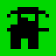 | 1 | **Κρητικός** | 35 | 1 | Μαυροφορεμένος, με κυνηγετικό τουφέκι. Χτυπά ντρόνα και πεζούς. |
| 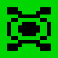 | 4 | **Ψσσστ** | 80 | 1 | Το ντρον που αυτομόλησε. Το λέιζερ του λιώνει και τη θωράκιση. Αιωρείται, οπότε κάθεται και σε τοίχους, δέντρα, τάφους και άλλα κελιά όπου δεν χτίζεται τίποτα. |
| 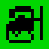 | 2 | **Γιαγιά** | 50 | 2 | Μαγκούρα και τσουκάλι με πικρά χόρτα: φρενάρει κάθε πεζό κοντά της και ρίχνει στον πιο κοντινό μια γερή. Τα ντρόνα δεν τα φτάνει. |
| 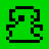 | 3 | **Νύφη** | 70 | 3 | Νυφικό και γρήγορο πιστόλι. Μία στις τέσσερις βολές είναι κρίσιμη, με τριπλή ζημιά. |
| 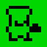 | 6 | **Φούρναρης** | 60 | 4 | Πετάει ντάκους (κριθαροκούλουρα) που πιτσιλάνε ό,τι είναι γύρω από τον στόχο. |
|  | 5 | **Καζάνι** | 110 | 5 | Τοξικό σύννεφο από «αδειοδότητα λιπίδια και ασκορβικά οξέα»: χτυπά κάθε πεζό γύρω του, αγνοώντας τη θωράκιση, και τον φρενάρει. Τα ντρόνα δεν τα φτάνει, και τα τανκς το στραπατσάρουν όταν περνούν δίπλα. |

### Γειτονιές

Κάποιοι υπερασπιστές τα πάνε καλύτερα δίπλα δίπλα, και κάποιοι μπαίνουν ο ένας στα πόδια του
άλλου. Ένας υπερασπιστής ακριβώς δίπλα στον «συνεργάτη» του – αριστερά, δεξιά, πάνω ή κάτω,
όχι διαγώνια – χτυπά πιο δυνατά ή πιο αδύναμα:

| Υπερασπιστής | δίπλα σε | Ζημιά |
| --- | --- | --- |
| Νύφη | Κρητικό | **+50%** |
| Γιαγιά | Φούρναρη | **+20%** |
| Φούρναρης | Κρητικό | **–50%** |
| Ψσσστ | Κρητικό | **–20%** |

Bonus μπορούν να έχουν μόνο τρεις υπερασπιστές τη φορά. Το κρατούν όσο μένουν δίπλα στον
συνεργάτη τους· ένας τέταρτος δεν παίρνει τίποτα, μέχρι να πουληθεί κάποιος από τους τρεις ή
να χάσει τον συνεργάτη του, οπότε το bonus περνά στον επόμενο που περιμένει. Τα αρνητικά
ισχύουν πάντα.

Πριν χτίσεις, η γραμμή πληροφοριών δείχνει το bonus που θα πάρει ο υπερασπιστής στο κελί του
κέρσορα: πράσινο για όφελος, κόκκινο για ζημία. Όταν τρεις υπερασπιστές έχουν ήδη bonus, δεν
δείχνει bonus.

## Οι εισβολείς

| | Εισβολέας | Τι κάνει |
| --- | --- | --- |
| 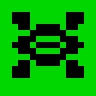 | **Βιο-ντρον** | Γρήγορο και εύθραυστο. Πετά από δικό του σύντομο δρόμο πάνω από τοίχους και δέντρα, οπότε το φτάνουν μόνο ο Κρητικός, ο Ψσσστ, η Νύφη και ο Φούρναρης. |
|  | **Φύλακας συμμόρφωσης της F&M** | Θωρακισμένος, με χορτοκοπτικό και ζιζανιοκτόνο. Η θωράκιση τρώει ένα μέρος από κάθε χτύπημα, εκτός από το σύννεφο του Καζανιού· το λέιζερ του Ψσσστ τη λιώνει. |
| 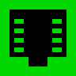 | **Καταστροφέας χόρτων** | Ερπυστριοφόρο τανκ με πολλή θωράκιση και ζωή. Στραπατσάρει τα Καζάνια δίπλα στον δρόμο και τα βγάζει εκτός μάχης για λίγα δευτερόλεπτα· αν περάσει, κοστίζει 20 ζωή. |

Οι εισβολείς δυναμώνουν σε κάθε κύμα. Σε μερικές πίστες έρχονται ακόμη πιο δυνατοί.

## Οι πίστες

<div class="stage" markdown="1">

**1. Το καφενείο.** Ο δρόμος κατεβαίνει από τα βουνά στο καφενείο του χωριού, με τη βεράντα
γεμάτη τσουβάλια με βρούβες.

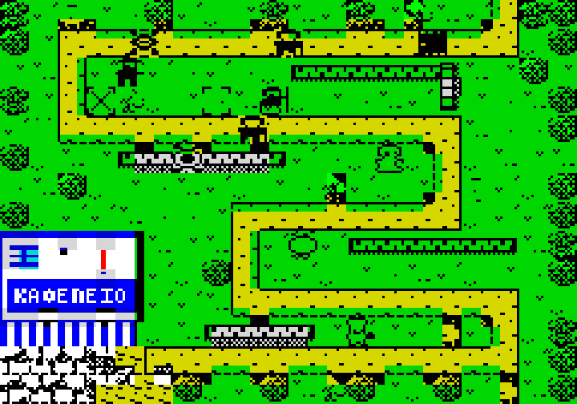

</div>

<div class="stage" markdown="1">

**2. Η εκκλησία του χωριού.** Τα χόρτα είναι κρυμμένα στην αυλή της εκκλησίας, δίπλα στον
παπά και στο μανουάλι. Ο δρόμος είναι πιο κοντός και τα κύματα λίγο μεγαλύτερα.

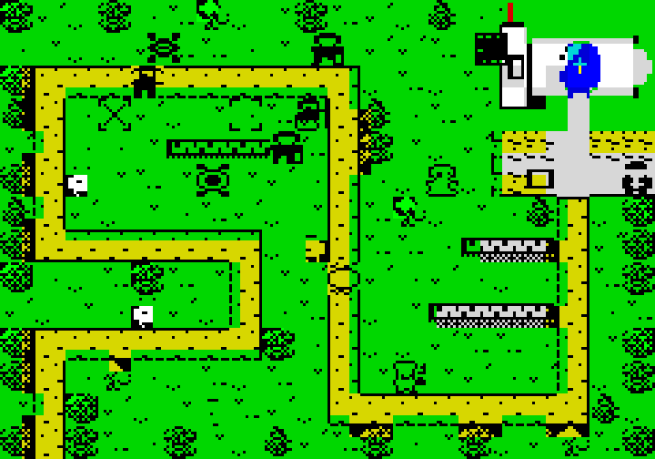

</div>

<div class="stage" markdown="1">

**3. Το δημαρχείο.** Στην πλατεία κάτω από τον γέρικο πλάτανο, δίπλα στη βρύση και στον
δήμαρχο. Εδώ οι εισβολείς είναι πιο δυνατοί από το συνηθισμένο.

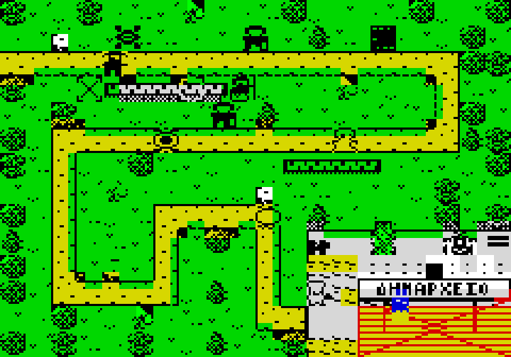

</div>

<div class="stage" markdown="1">

**4. Ο φούρνος.** Στην αυλή του φούρνου δίπλα στον ξυλόφουρνο, ανάμεσα στα ξύλα και στις
ψάθες με τα ντάκους που στεγνώνουν. Ο δρόμος διασχίζει τον χάρτη σε τρεις κοντινές λωρίδες.

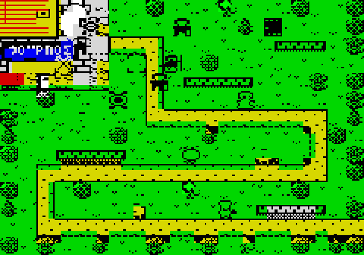

</div>

<div class="stage" markdown="1">

**5. Το σχολείο.** Στην αυλή του σχολείου με το γήπεδο του μπάσκετ, τη σημαία και τη δασκάλα.

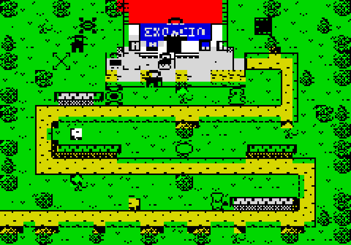

</div>

<div class="stage" markdown="1">

**6. Το γήπεδο του χωριού.** Τα χόρτα περιμένουν στην πλάγια γραμμή, δίπλα στον προπονητή και
στον πάγκο, κάτω από την κερκίδα γεμάτη χωριανούς. Ο δρόμος κάνει τον γύρο του γηπέδου και
μπορείς να χτίσεις και πάνω στο γρασίδι του· τα ντρόνα περνούν ίσια από πάνω του.

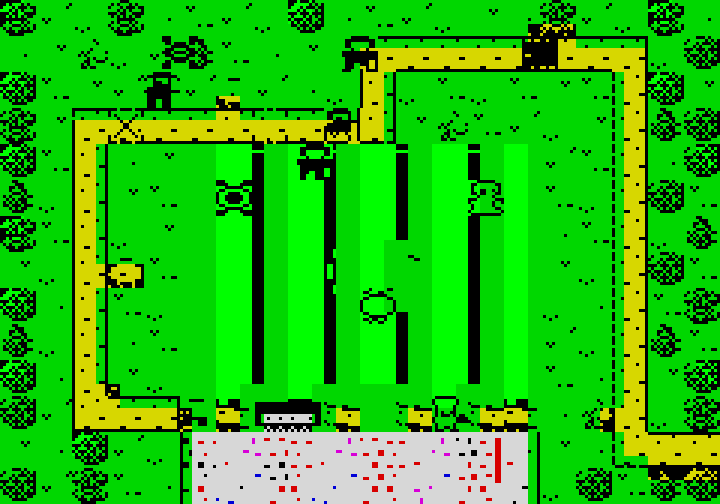

</div>

<div class="stage" markdown="1">

**7. Η εκκλησία του νεκροταφείου.** Η τελευταία μάχη, στο πέτρινο εκκλησάκι ανάμεσα στους
τάφους και στα κυπαρίσσια. Ο δρόμος περνά ανάμεσα από τους τάφους, όπου δεν χτίζεται τίποτα –
εκτός από τον Ψσσστ, που αιωρείται.

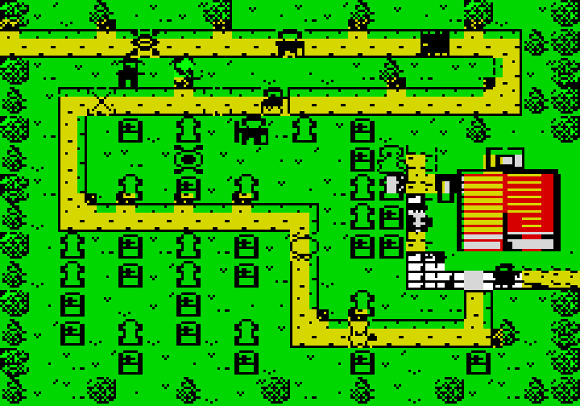

</div>

## Συμβουλές

* Ψάξε τις στροφές: ένας υπερασπιστής δίπλα σε δύο κομμάτια δρόμου πυροβολεί τα πάντα δύο
  φορές.
* Οι Κρητικοί είναι φτηνοί και χτυπούν τα πάντα, αλλά ένα κύμα από ντρόνα περνά άνετα από μια
  άμυνα που χτυπά μόνο πεζούς. Κράτα κάτι που χτυπά στον αέρα κοντά στον δρόμο των ντρόνων.
* Βάλε τις Νύφες δίπλα στους Κρητικούς, και κράτα τους Φούρναρηδες και το Ψσσστ ένα βήμα πιο
  μακριά τους.
* Βάλε τη Γιαγιά στις στροφές του δρόμου, ώστε οι φρεναρισμένοι πεζοί να μένουν περισσότερο
  κάτω από τα πυρά.
* Απέναντι στους θωρακισμένους φύλακες και στα τανκς, το λέιζερ του Ψσσστ και το σύννεφο του
  Καζανιού αξίζουν τα λεφτά τους. Κράτα τα Καζάνια ένα βήμα μακριά από τον δρόμο, μακριά από
  τα τανκς.
* Ο Ψσσστ κάθεται σε τοίχους, δέντρα και τάφους: χρησιμοποίησε τα κελιά που δεν παίρνει
  κανένας άλλος.
* Φέρνε τα κύματα νωρίτερα όταν η άμυνά σου αντέχει άνετα: το μπόνους μαζεύεται.

---

*ΠΑΜΕ ΓΙΑ ΒΡΟΥΒΕΣ – REVIVE8BIT - 2026 - VASPER.*
